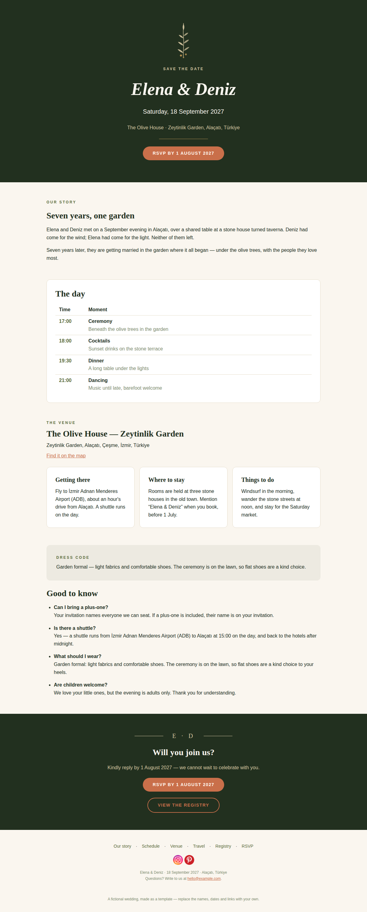
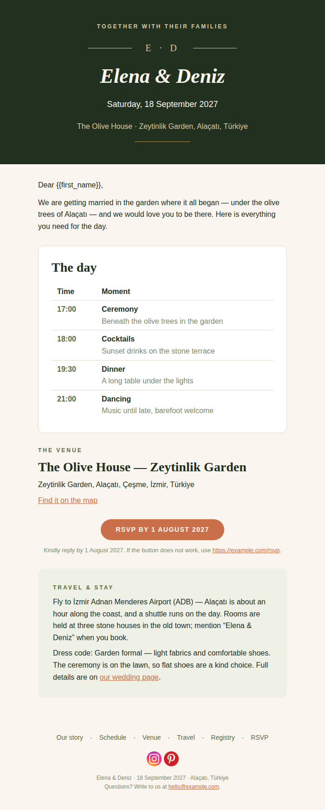
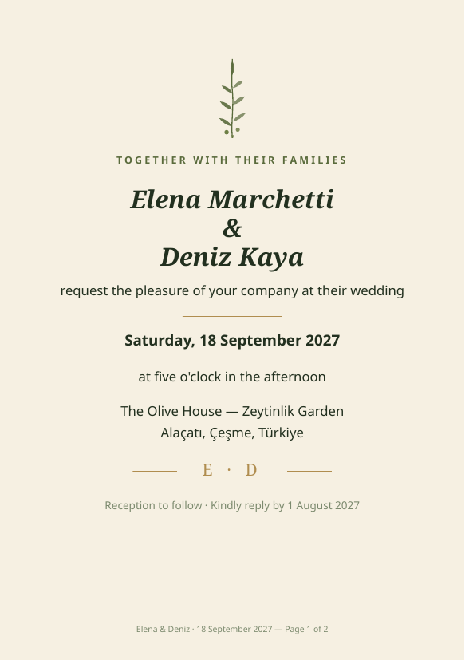
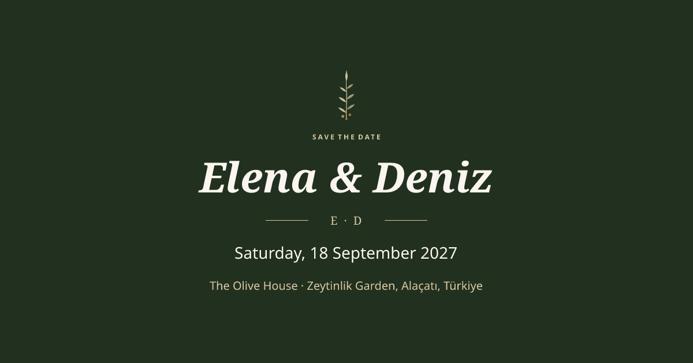

# Elena & Deniz — an Aegean wedding invitation kit

A destination wedding invitation kit built with [Hyper Elements](https://hyperelements.dev):
one data file and one theme render **four artifacts** — an invitation email, an RSVP web page,
a printable PDF invitation and a save-the-date social card. Change a time or a venue in
[`src/data.ts`](src/data.ts) and it changes everywhere.

All names, people and places in this kit are fictional. It was made for the
Hyper Elements Template Challenge.



## The four artifacts

| Artifact | Root | Output |
| --- | --- | --- |
| Invitation email, 600 wide | `Email` | `out/email.html` + `out/email.txt` |
| RSVP web page, 960 wide | `Page` | `out/page.html` |
| Printable invitation, A5 portrait, 2 pages | `Document` | `out/invitation-print.html` + `out/invitation.pdf` |
| Save-the-date card, 1200 × 630 | `Canvas` | `out/social-card.png` |

### Invitation email

Typographic hero — `Svg` is not supported in email, so the monogram and rules carry the
ornament — with `MergeTag` personalisation (`Dear {{first_name}},`), the schedule table,
venue and travel details, an RSVP button and a `Menu` + `Social` footer. It renders at
about 26 KB, well under Gmail's 102 KB clip limit; the build fails if it ever goes over.



### Printable invitation

Page one is the formal invitation with the olive-branch art; page two holds the schedule,
dress code and travel, split with a `PageBreak`, with a `PageFooter` carrying
`PageNumber` ("Page X of Y"). The print cut of the theme uses bone paper and the Noto
fonts, given as files to `renderPdf()`.



### Save-the-date card



## How Hyper Elements is used

- **One data file, one theme.** [`src/data.ts`](src/data.ts) is the single source of truth
  for the couple, the date, the venue, the schedule, travel, dress code and FAQ.
  [`src/theme.ts`](src/theme.ts) defines the "Aegean" theme with `defineTheme`: cream paper,
  deep olive ink, terracotta primary, gold accent, Georgia display type over a system sans
  body, pill buttons with `primary` and `outline` variants, and named styles (`card`,
  `kicker`, `band`). Its `formats.email` override turns the translucent olive band into a
  solid tint in email, where translucent fills render unevenly. `extendTheme` makes two
  cuts from it: `printTheme` (bone paper, Noto fonts) for the PDF and `canvasTheme`
  (Noto fonts) for the social card.
- **Shared components, genuinely shared.** [`src/components.tsx`](src/components.tsx) holds
  `OliveBranch` (an `Svg` sprig drawn with `Path` stems, pointed-leaf paths and `Circle`
  olives — fixed coordinates, no randomness), `Monogram`, `ScheduleTable`, `InfoGrid`,
  `VenueBlock`, `FaqList`, `RsvpButton` and `Footer`. The same components render inside the
  `Email`, the `Page`, the `Document` and the `Canvas` wherever the elements allow —
  `Svg` cannot go in an email, so the email gets the typographic monogram instead, and
  `Social`/`Menu` are email/web elements, so the print invitation and the card carry a
  plain-text footer. `InfoGrid` has a compact `layout="table"` form for the print page,
  where a page's room is fixed and anything taller is cut off.
- **Four roots, four writers.** [`src/templates/email.tsx`](src/templates/email.tsx) (`Email`),
  [`src/templates/page.tsx`](src/templates/page.tsx) (`Page`),
  [`src/templates/document.tsx`](src/templates/document.tsx) (`Document`, A5, `PageBreak`,
  `PageFooter` with `PageNumber`) and
  [`src/templates/canvas.tsx`](src/templates/canvas.tsx) (`Canvas`, 1200 × 630).
- **One build script.** [`src/render.ts`](src/render.ts) validates all four templates with
  `validate()` — the email with the `emailClients()` plugin from
  `@hyper-elements/email-clients`, which checks what classic Outlook, Gmail, Apple Mail and
  the others remove or change — prints `formatDiagnostics` and `outline()` for each, and
  fails on any error. It renders with `render()` (email HTML + plain text, page HTML, print
  HTML), `renderPdf()` (the invitation PDF, with the Noto font files from
  [`src/fonts.ts`](src/fonts.ts) and [`assets/fonts/`](assets/fonts/)) and `renderImage()`
  (the social card PNG), then runs `renderInEmailClients()` for Outlook, Gmail and Apple
  Mail and writes the previews to `out/clients/`. Every output file's byte size is logged.
  Output is deterministic: no dates or random numbers anywhere in the templates.
- **Screenshots.** [`scripts/screenshot.mjs`](scripts/screenshot.mjs) screenshots the page
  and the email with Playwright's Chromium and copies the social card into `docs/`. It
  finds a Chromium already cached by another Playwright version, hands Chromium the proxy
  from the environment where one is set, and inlines the remote social icons into temporary
  copies of the HTML so the screenshots show them even where the browser cannot reach the
  network.
- **Tests.** [`src/render.test.ts`](src/render.test.ts) (`tsx --test`) asserts `validate()`
  is valid for all four templates, the email HTML is under 102 KB, the social card is
  1200 × 630, and the PDF bytes start with `%PDF`.

## Run it

Prerequisites: Node 20+ and npm.

```bash
npm install
npm run build        # validate + render everything into out/
npm run screenshots  # page + email screenshots into docs/ (needs Chromium: npx playwright-core install chromium)
npm test             # validation, size and format checks
npm run typecheck    # tsc --noEmit
```

Outputs, all under `out/`:

- `email.html`, `email.txt` — the invitation email and its plain-text form
- `page.html` — the RSVP web page
- `invitation-print.html`, `invitation.pdf` — the printable invitation (2 pages)
- `social-card.png` — the save-the-date card, 1200 × 630
- `clients/outlook.html`, `clients/gmail.html`, `clients/apple-mail.html`,
  `clients/apple-mail.iphone.html` — the email as each client draws it

## Make it yours

- **The wedding:** edit [`src/data.ts`](src/data.ts) — names, date, venue, schedule,
  travel, dress code, FAQ. Every artifact follows.
- **The look:** edit the theme in [`src/theme.ts`](src/theme.ts) — colours, fonts, button
  variants, named styles. The print and canvas cuts extend it with `extendTheme`.
- **The links:** every link in the kit points at `https://example.com/...` placeholders
  (RSVP is `https://example.com/rsvp`). Replace them in `src/data.ts` with your own site,
  RSVP form, map and social profiles.
- **The fonts:** the PDF and the social card use Noto Serif and Noto Sans from
  `assets/fonts/` (SIL Open Font License 1.1, see
  [`assets/fonts/NOTICE.md`](assets/fonts/NOTICE.md)). Swap the files and the family names
  in `src/fonts.ts` to use your own.

## License

MIT — see [LICENSE](LICENSE). By [cezo484](https://github.com/cezo484).
